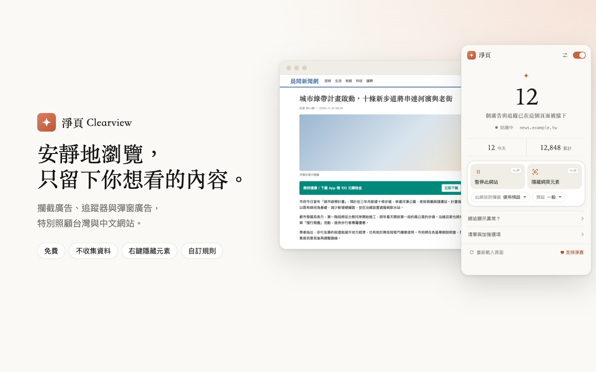
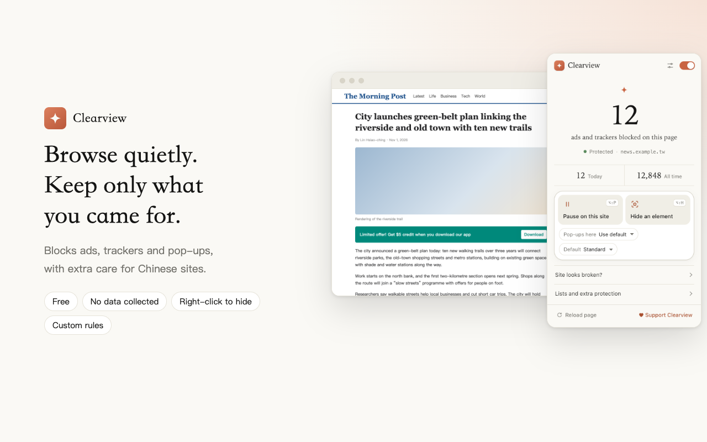

# 淨頁 Clearview

**繁體中文** · [English](#english)

免費、開源的廣告攔截擴充功能，特別照顧台灣、香港與中國網站。

## 安裝

| 瀏覽器 | 方式 |
|---|---|
| Firefox | [Firefox 附加元件商店](https://addons.mozilla.org/zh-TW/firefox/addon/%E6%B7%A8%E9%A0%81-clearview-%E5%BB%A3%E5%91%8A%E6%94%94%E6%88%AA/) |
| Opera | Opera 附加元件商店（審核中） |
| Chrome、Edge、Brave | 商店上架前，可從 [Releases](https://github.com/xiongcarl/clearview/releases/latest) 下載 `clearview-chromium-*.zip`，解壓縮後到 `chrome://extensions` 開啟「開發人員模式」，按「載入未封裝項目」選擇該資料夾 |

## 功能
- 攔截廣告、追蹤器與彈窗廣告：EasyList、EasyPrivacy、AdGuard 中文、uBlock 修正、HaGeZi
- YouTube 等網站的影片廣告與「請關閉廣告攔截器」提示
- 右鍵「隱藏這個元素…」，漏網廣告一鍵移除
- 我的過濾規則：支援 Adblock Plus / uBlock Origin 常見語法
- 攔截統計、分站暫停與相容模式、鍵盤快捷鍵
- 介面：繁體中文、简体中文、English

## 隱私
不收集任何資料，沒有「可接受廣告」，所有過濾都在你的電腦上完成。見 [PRIVACY.md](PRIVACY.md)。

## 支持開發
淨頁免費提供。如果它讓你上網清爽一點，歡迎到 [Ko-fi](https://ko-fi.com/clearview) 贊助。

## 開發
- 更新紀錄：[CHANGELOG.md](CHANGELOG.md)
- 建置與打包：[BUILD.md](BUILD.md)（擴充功能本體在 [`extension/`](extension/)）
- 授權：GPL-3.0-or-later，見 [LICENSE](LICENSE) 與 [THIRD-PARTY-NOTICES.md](THIRD-PARTY-NOTICES.md)

---

## English

A free, open-source ad blocker with extra care for sites in Taiwan, Hong Kong and China.

### Install

| Browser | How |
|---|---|
| Firefox | [Firefox Add-ons](https://addons.mozilla.org/en-US/firefox/addon/%E6%B7%A8%E9%A0%81-clearview-%E5%BB%A3%E5%91%8A%E6%94%94%E6%88%AA/) |
| Opera | Opera add-ons (in review) |
| Chrome, Edge, Brave | Until the store listing is live, download `clearview-chromium-*.zip` from [Releases](https://github.com/xiongcarl/clearview/releases/latest), unzip it, open `chrome://extensions`, turn on Developer mode and choose "Load unpacked" |

### Features
- Blocks ads, trackers and pop-ups: EasyList, EasyPrivacy, AdGuard Chinese, uBlock fixes, HaGeZi
- Handles video ads and "please disable your ad blocker" walls on sites such as YouTube
- Right-click "Hide this element…" for anything that slips through
- Custom filter rules in common Adblock Plus / uBlock Origin syntax
- Statistics, per-site pause and compatibility mode, keyboard shortcuts
- Interface in English, Traditional Chinese and Simplified Chinese

### Privacy
Collects no data, no "acceptable ads"; all filtering runs on your computer. See [PRIVACY.md](PRIVACY.md).

### Support
Clearview is free. If it makes your web calmer, you can support it on [Ko-fi](https://ko-fi.com/clearview).

### Development
[CHANGELOG.md](CHANGELOG.md) · [BUILD.md](BUILD.md) (the extension itself is in [`extension/`](extension/)) · License: GPL-3.0-or-later ([LICENSE](LICENSE), [THIRD-PARTY-NOTICES.md](THIRD-PARTY-NOTICES.md))
